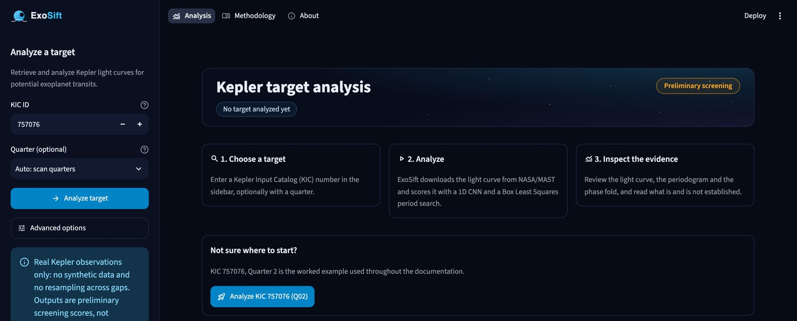
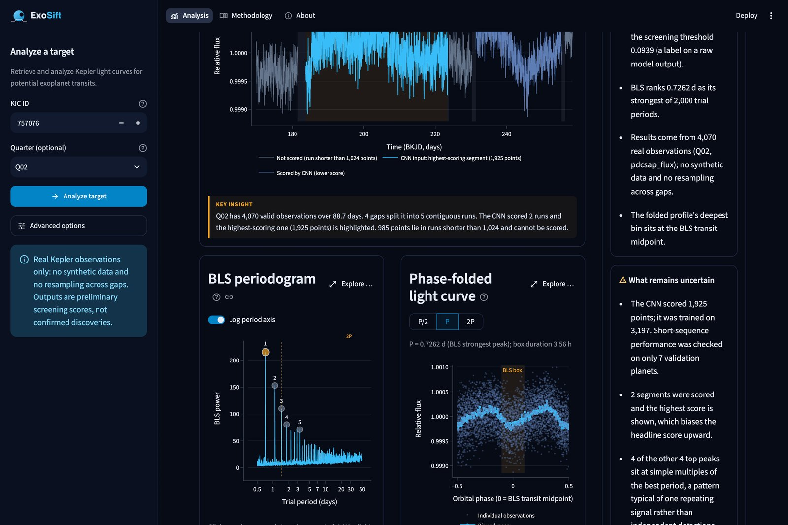
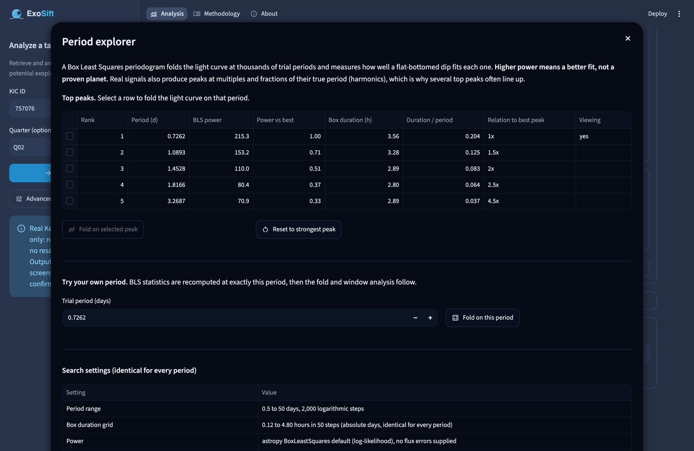
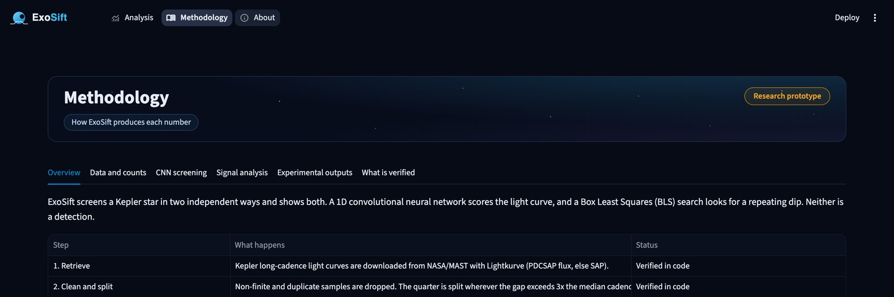

# 🔭 ExoSift

**AI-assisted screening for exoplanet transit candidates in real NASA Kepler data.**

ExoSift downloads real brightness measurements of a star from NASA's Kepler mission, runs them through a neural network and a classic signal-detection algorithm, and shows you both results side by side — along with an honest account of what the numbers do and don't prove.

> ⚠️ **This is a screening tool, not a discovery tool.** Nothing it outputs is a confirmed exoplanet. Every score is a candidate signal that still needs expert, independent verification.

---

## What this project actually does (in plain words)

When a planet passes in front of its star, the star's brightness dips very slightly — often by less than one part in a thousand — and that dip repeats on a regular schedule, once per orbit. ExoSift looks for that pattern in **real Kepler telescope data** two different ways at once:

1. **A neural network "looks" at the brightness curve** the way an image classifier looks at a photo, and outputs a score for "does this look like the patterns I learned from labelled examples."
2. **A classical algorithm (Box Least Squares) searches for a repeating dip** at thousands of candidate orbital periods, independently of the neural network.

You type in a star's catalog number, ExoSift fetches its real observations from NASA's archive, and the dashboard shows you the light curve, both analyses, and — importantly — how much to trust each number.

## See it in action

**Pick a target, get an instant readout.** Enter a Kepler Input Catalog (KIC) number and ExoSift pulls the real light curve, scores it, and summarizes the result in one glance — the CNN score, the strongest repeating period found, how much of the star's data was actually usable, and a plain-language verdict.



**Every chart explains itself.** The light curve shows exactly which stretch of data the AI model scored (and why the rest couldn't be used); the periodogram and phase-fold update live as you click different candidate periods; and a running "what supports this / what's still uncertain" panel keeps the verdict honest.



**Every peak is explorable, not just decorative.** Click any candidate period in the periodogram (or type your own) to instantly re-fold the data on it and see the search settings that produced it.



**A built-in methodology page** explains exactly how every number is computed, in order, with a verified/experimental status for each one — no number is presented as more certain than it is.



## Main insights from this project

These are the real, tested findings behind the dashboard's "what's uncertain" panel — not marketing claims. Full derivations and the experiments behind them are in [`docs/scientific_audit.md`](docs/scientific_audit.md).

- **The neural network is genuinely good *on its training data*, but that data is tiny.** On the Kaggle Kepler benchmark it reaches 0.998 ROC-AUC — but training data is only 37 confirmed planets against 5,050 non-planets, and the held-out test set has just 5 planets. One extra correct or incorrect call swings recall by ~14–20 percentage points. The headline accuracy numbers are real, but they rest on very few positive examples.
- **A model trained on one input length still works reasonably well at a different length — but this hasn't been fully proven.** The CNN was trained on fixed 3,197-point sequences. Real Kepler data doesn't come in that exact size, so ExoSift rebuilds the network to accept any length and transfers the exact trained weights (verified mathematically identical — see the audit). Accuracy at the shorter lengths actually used in practice was checked, but again on only 7 validation planets.
- **A repeating-signal score can look convincing and still be indistinguishable from noise.** One of the dashboard's experimental metrics ("window consistency") scored 0.781 on a real star — which sounds reasonably high — until it was re-run on the same star's brightness data *randomly shuffled in time* (destroying any real signal). The shuffled versions scored 0.76–0.78, the same range. This metric is now explicitly labeled experimental and excluded from the main verdict, and the dashboard shows this exact shuffled-data comparison live.
- **A "calibrated probability" can be mathematically correct and still misleading.** A standard calibration technique (Platt scaling) was applied to turn raw model scores into probabilities. The math is correct, but it was fit on extremely few examples and a slightly different version of the model than the one producing the live score — so its output is reported, but clearly labeled as not a reliable real-world probability.
- **Several of the strongest "repeating signal" peaks found by the classical algorithm are just harmonics of one single underlying period** (exact multiples like 2x, 2.5x, 4.5x) — a pattern typical of one periodic signal (which may or may not be a planet) rather than independent discoveries. The dashboard flags this automatically rather than listing them as separate candidates.

The project's engineering practice matches its science: every one of these findings was *found by deliberately testing the system* (shuffled-data controls, side-by-side comparison against the original unmodified code, weight-equality checks between model versions) rather than assumed, and the dashboard reports them to the user instead of hiding them.

## What machine learning is used, and how

| Stage | Technique | What it's for |
|---|---|---|
| **Screening score** | 1D Convolutional Neural Network (Keras/TensorFlow) | Learns shape patterns in the brightness curve associated with labelled transit examples |
| **Period search** | Box Least Squares (BLS, via `astropy`) | A classical (non-ML) algorithm that tests thousands of candidate orbital periods for a repeating box-shaped dip |
| **Baseline model** | Random Forest (`scikit-learn`) | An earlier, hand-engineered-feature baseline kept for comparison against the CNN |
| **Probability mapping** | Platt scaling (logistic regression) | Attempts to turn the CNN's raw score into a probability-like number (experimental, see insights above) |

**The CNN architecture** — three convolutional blocks that each look for patterns at a different scale, each followed by batch normalization, a ReLU activation, pooling, and dropout to reduce overfitting; then global average pooling (which is what lets the same trained network handle inputs of *any* length) and two dense layers ending in a single 0–1 score:

```
Conv1D(32, kernel=15) → BatchNorm → ReLU → MaxPool(4) → Dropout(0.15)
Conv1D(64, kernel=11) → BatchNorm → ReLU → MaxPool(4) → Dropout(0.20)
Conv1D(128, kernel=7) → BatchNorm → ReLU → MaxPool(4) → Dropout(0.25)
GlobalAveragePooling1D
Dense(64, ReLU) → Dropout(0.40)
Dense(1, sigmoid)                         # the final screening score
```

**End-to-end pipeline, in order:**

1. **Retrieve** — download real Kepler light curves from NASA/MAST via the `lightkurve` package.
2. **Clean** — drop invalid samples, split the data at any real observing gap (never bridge or interpolate across one).
3. **Screen** — score every usable contiguous stretch with the CNN; the highest score becomes the headline.
4. **Search for periodicity** — run a BLS period search across the *entire* cleaned quarter.
5. **Phase-fold** — fold the brightness data on any candidate period to visually check whether a consistent dip shows up.
6. **Window evidence** (experimental) — check whether the dip repeats consistently in depth, duration and timing.
7. **Calibrate** (experimental) — map the raw score toward a probability-like number.
8. **Combine** (experimental) — blend the above into one composite score.

Each stage's full methodology — including the formulas, the exact weights, and which outputs are verified versus experimental — is documented live in the app's **Methodology** page and in [`docs/scientific_audit.md`](docs/scientific_audit.md).

---

## Repository contents

| Path | Contents |
|------|----------|
| `src/` | All pipeline scripts: preprocessing, training, periodicity, phase-folding, calibration, the analysis orchestrator |
| `app/` | The Streamlit dashboard (entry point, pages, and UI components) |
| `data/raw/` | Kaggle CSV downloads (excluded from git — see `.gitignore`) |
| `data/processed/` | Regenerable preprocessed arrays (excluded from git) |
| `models/` | Trained model weights and evaluation artifacts |
| `docs/` | Scientific audit and screenshots |
| `tests/` | Offline regression tests (no network/model download required) |

## Evaluation results (V1, Kaggle test set)

| Model | ROC-AUC | PR-AUC | Precision | Recall | F1 | Threshold |
|-------|---------|--------|-----------|--------|----|-----------|
| Random Forest (default 0.50) | 0.8931 | 0.2545 | 0.0000 | 0.0000 | 0.0000 | 0.50 |
| Random Forest (validation-selected) | 0.8931 | 0.2545 | 0.1000 | 0.8000 | 0.1778 | 0.1148 |
| 1D CNN (default 0.50) | 0.9982 | 0.7100 | 0.8000 | 0.8000 | 0.8000 | 0.50 |
| 1D CNN (validation-selected) | 0.9982 | 0.7100 | 0.8333 | 1.0000 | 0.9091 | 0.0939 |

> **Important:** The test set contains only **five positive planet examples**. A single example swings recall by 20% and F1 by ~0.18. These metrics are evidence about this specific Kaggle split, not proof of real-world exoplanet discovery capability. Thresholds were selected **only** on validation data — never on the held-out test set.

## Key limitations (read before using results)

1. **Extreme class imbalance:** 37 planet training examples. Metrics are noisy and not conclusive.
2. **Test-set size:** Only 5 positive test examples. Do not treat test metrics as proof of generalization.
3. **Uncalibrated scores:** CNN sigmoid outputs are not reliable real-world probabilities, even after Platt scaling (see insights above).
4. **Variable-length CNN has limited validation:** Performance at lengths other than 3,197 has been checked on only 7 validation planets.
5. **Preprocessing tuned on Kaggle data:** Detrending/normalization parameters (trend window 101, MAD threshold 7.0, clip ±5.0) were tuned on the Kaggle CSV layout and may not be optimal for every real Kepler quarter.
6. **BLS periodicity is heuristic:** "Power" ranks candidate periods; it is not a calibrated significance test, and harmonics of one signal frequently appear as several top peaks.
7. **Window-consistency, calibrated probability, and the composite score are experimental** — see "Main insights" above and `docs/scientific_audit.md` for why.

## Contributing

This is a learning-oriented, scientifically careful project. Changes are made one logical step at a time, with verification after each. Please open an issue to discuss before proposing significant changes.

## License

[To be added]
